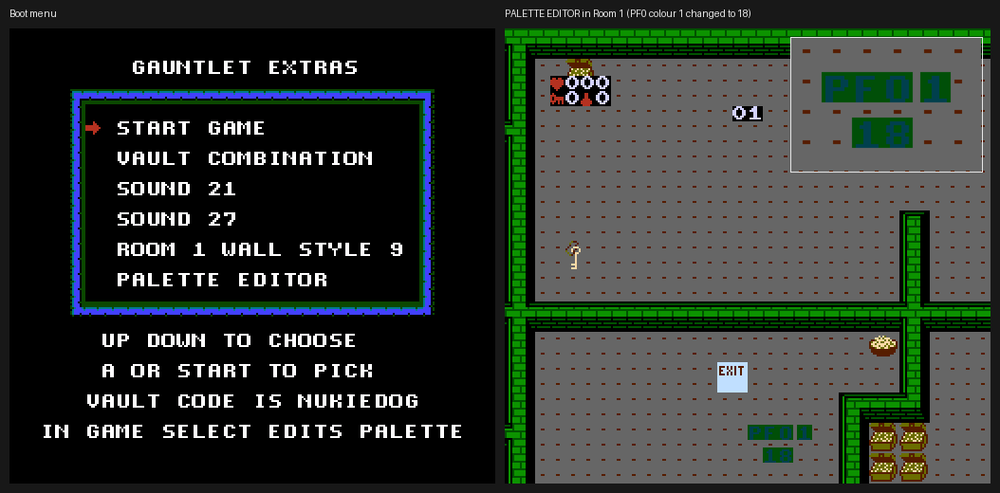

# Gauntlet (NES) extras

Hidden and cut content in **Gauntlet (USA)** for the NES (Tengen, 1988), plus an IPS patch that puts the parts you can show on a boot menu.

- [**WRITEUP.md**](WRITEUP.md): the technical breakdown. It covers the dormant palette editor, two developer test rooms, six level maps no room uses, an unused wall tileset, a cut credit line, two sound effects nothing plays, an unfinished item, an unused random-input demo mode and orphaned code. It also explains how the clue rooms and the NUKIEDOG vault combination work. Each finding has ROM offsets, bytes, Game Genie codes and RAM addresses.
- [**patch/gauntlet-extras-menu.ips**](patch/gauntlet-extras-menu.ips): the boot-menu patch described below.

No ROM is included. You need your own dump.

## The extras-menu patch

### Base ROM

| | Clean ROM | After patching |
| --- | --- | --- |
| File | `Gauntlet (USA).nes`, iNES, 196,624 bytes | same size |
| MD5 | `d6c977caa1d5a1deaeedbfe5668db01d` | `878c04ecedb3dd97ca86e1034b51dee1` |
| SHA-1 | `a9a3fa65d5464e48611773087f6dbb9d496185f8` | `1bc777e200dd592b7f1e96d01ff3d8440d9f7966` |
| CRC32 (whole file) | `64BF0E3C` | `5995FFF7` |
| CRC32 (without header) | `EC968C51` | `D1BC7D9A` |

Apply it with any IPS patcher, such as Floating IPS (Flips) or Rom Patcher JS.

### The menu

The menu appears before the title screen at power-on and after the game's A+B+Select+Start soft reset. Up and Down move the arrow, and A or Start picks an item.

| Item | What it does |
| --- | --- |
| START GAME | Goes to the title screen and plays normally. |
| VAULT COMBINATION | Steps through the title, player-count and hero screens for you, then drops you at Morak's combination screen in Room 100. Enter `NUKIEDOG`. |
| SOUND 21 | Plays unused sound effect `$21`. The menu stays up. |
| SOUND 27 | Plays unused sound effect `$27`. The menu stays up. |
| ROOM 1 WALL STYLE 9 | Steps through the setup screens and starts in Room 1, drawn with the tenth wall style that no map selects. It stays that way until the next reset. |
| PALETTE EDITOR | Steps through the setup screens and opens the dormant palette editor as soon as Room 1 begins. |

### Changes in every game started from the menu

- **`NUKIEDOG` always opens the vault.** The patch removes the password key from the combination check, so the combination no longer changes from game to game. The clue rooms still reveal the original, key-scrambled letters, so those letters no longer match.
- **Select opens the palette editor** in any room.

### Using the palette editor

| Button | Effect |
| --- | --- |
| Left / Right | Pick one of the 32 palette entries (wraps around) |
| Up / Down | Change that entry's colour by one step, `$00`–`$3F` |
| A | Close the editor and carry on playing |

The readout at the bottom of the screen shows **PF** (background, "playfield") or **MO** (sprite, "motion object"), the palette number, the colour number within it, and the value in hex. Each press moves one step, and holding a button doesn't repeat. To change the backdrop colour, edit MO palette 0, colour 0. Edits last until you leave the room, because every room loads its own palettes.

### How it works

- The menu code sits in PRG bank 10, which is empty (all zeros) in the retail ROM. The other pieces sit in the zero-filled gaps of banks 0, 14 and 15.
- Hooks: the reset path (`$FFA0`), the title-screen call (`$C087`), the start of a game (`$C0E0`), the joypad read (`$C353`), the in-room loop (`$C492`), the room loader's wall-style byte (bank 0 `$82A3`) and the combination check (bank 13 `$A281`).
- It keeps its state in zero-page bytes `$DE`, `$F1`–`$F3`, `$F5`–`$F7` and `$F9`–`$FB`, which the game itself never read or wrote in about 700,000 frames of logged play.
- The palette editor is the game's own, at bank 12 `$8003`. The patch only calls it and then restores the sprite graphics bank the editor borrows for its font.

The Game Genie codes in [WRITEUP.md](WRITEUP.md#11-see-it-yourself) reach the test rooms and unused maps without patching.
