# Gauntlet (NES) – Cut Content & Hidden Features: Technical Breakdown

Last updated October 17, 2026.

Gauntlet (USA) still holds a working palette editor, two developer test rooms, six level maps no room uses, an unused wall tileset, a credit line cut from the roll, and two sound effects nothing plays.

## Overview

All offsets are **file offsets** in the 196,624-byte iNES dump, header included. CPU addresses are given alongside, with the bank that has to be mapped in for them to apply.

| Item | Value |
| --- | --- |
| File | Gauntlet (USA).nes, 196,624 bytes |
| MD5 | d6c977caa1d5a1deaeedbfe5668db01d |
| SHA-1 | a9a3fa65d5464e48611773087f6dbb9d496185f8 |
| CRC32 (without header) | EC968C51 |
| Board | Mapper 206 (Namco 108 type), four-screen VRAM |
| PRG / CHR | 128 KB in sixteen 8 KB banks / 64 KB |

**Address math.** File offset = 0x10 + bank × 0x2000 + (CPU address − window base). Banks 0, 1, 3, 8 and 12 run at $8000. Banks 2, 4–7, 9 and 13 run at $A000. Bank 14 is fixed at $C000 and bank 15 at $E000. CHR file offset = 0x20010 + CHR address. Each switchable bank stores its own number at byte 2, which the NMI reads back from $8002/$A002 to restore banks.

**How it was checked.** An instrumented emulator logged every executed byte, every data read and every tile drawn. It ran about 700,000 frames, a little over three hours of play: all 100 rooms with each hero, every two-player hero pairing, the attract loop, password entry, game over and the ending. A static trace from the executed code then found the code nothing reaches and the data nothing reads. Each finding that can run was then run in the emulator. The orphaned fragments in section 8 were checked by reading the code.

| # | Finding | Category | Main offset |
| --- | --- | --- | --- |
| 1 | Palette editor with "PF"/"MO" labels | Debug | 0x18013 |
| 2 | Two developer test rooms (slots 102 and 103) | Debug | 0x0082D |
| 3 | Six level maps no room uses | Leftovers | 0x0CCFB |
| 4 | A tenth wall style no map selects | Leftovers | 0x26410 (CHR) |
| 5 | Credit line SPECIAL THANKS TO RANDY BROWELEIT | Leftovers | 0x0FBA5 |
| 6 | Sound effects `$21` and `$27` | Dormant | 0x11082 |
| 7 | Item type `$40` | Unfinished | 0x05BE0 |
| 8 | Random-input demo mode `$12` | Fossils | 0x1C3F3 |
| 9 | Seven orphaned routines and a dead branch | Fossils | 0x1811D |
| 10 | The vault combination is the word NUKIEDOG | Hidden in Plain Sight | 0x06EFA |
| 11 | Clue letters hide in locked chests and a breakable wall | Hidden in Plain Sight | 0x00830 |
| 12 | The Extra Magic potion is in Rooms 16 and 50 | Hidden in Plain Sight | 0x00915 |
| 13 | Password instructions appear only after a game over | Hidden in Plain Sight | 0x06063 |
| 14 | A+B+Select+Start soft reset | Hidden in Plain Sight | 0x1C3AD |
| 15 | The attract demo plays in its own room slot | Hidden in Plain Sight | 0x1C6B4 |

## 1. Palette editor — Debug (dormant)

Bank 12 starts with a complete, working palette editor that nothing in the game calls. It edits the 32-byte palette buffer at RAM $0192–$01B1 live and labels background palettes **PF** and sprite palettes **MO**. Those are "playfield" and "motion object", the terms Atari's arcade hardware used.

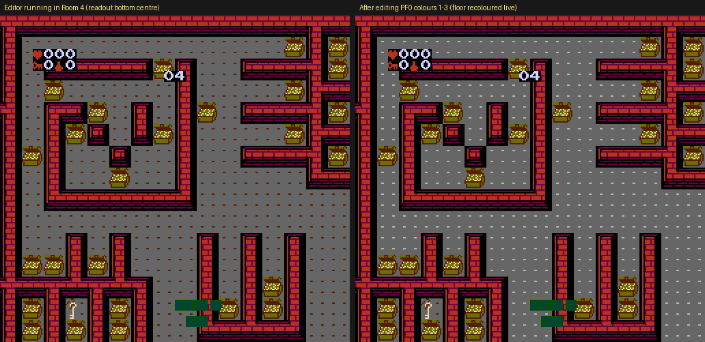

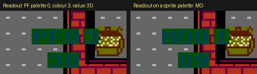

**Controls.** Left/Right picks one of the 32 entries (wraps at 32). Up/Down changes its colour by one (masked to $00–$3F). A returns to the caller. The readout is six sprites at the bottom of the screen: PF or MO, palette number, colour number, then the value in hex.

| Part | Bank / CPU | File offset | Bytes |
| --- | --- | --- | --- |
| Entry (sets mode $0E) | 12 / $8003 | 0x18013 | A5 C2 48 A9 0E 85 C2 A5 00 29 08 4A |
| Sprite template (6 sprites) | 12 / $80E1 | 0x180F1 | D0 00 03 80 D0 00 03 88 … |
| "PF" / "MO" tile numbers | 12 / $80F9 | 0x18109 | 99 8F 96 98 |
| Hex digit tiles 0–F | 12 / $80FD | 0x1810D | 80 81 … 8F |
| Mode $0E NMI handler | 3 / $9B69 | 0x07B79 | 20 4B 9B E6 05 20 D5 9A 4C AA C1 |
| Palette upload it uses | 3 / $9B4B | 0x07B5B | copies $0192–$01B1 to PPU $3F00 |
| NMI table entry for mode $0E | 14 / $C1E1 | 0x1C1F1 | 69 9B (bank byte 03 at 0x1C209) |

**Why it is dormant.** The fixed bank switches bank 12 in at exactly three places, $C110, $C5E4 and $C758, and they call $8349, $81A5 and $8181. The NMI table adds one more use, $8683, for the ending (mode $09). No code calls $8003 with bank 12 mapped, and mode $0E is set nowhere else. The tile numbers point at the digit font in CHR $F800 (file 0x2F810), which the editor maps in itself.

**To run it in an emulator:** break at $C489 (top of the in-room loop), write the 26 bytes `A9 06 8D 00 80 A9 0C 8D 01 80 20 03 80 A9 06 8D 00 80 A9 01 8D 01 80 4C 89 C4` to RAM $01C0, then set PC to $01C0. Press A to leave the editor, and the room carries on.

## 2. Two developer test rooms — Debug

The room table has 104 slots, not 100. Slots `$00`–`$63` are Rooms 1–100, slot `$64` is the attract demo, and slots `$65` and `$66` point at two test maps that load and play normally. Slot `$67` points at map `$5F`, whose pointer is `$0000`: an empty placeholder.

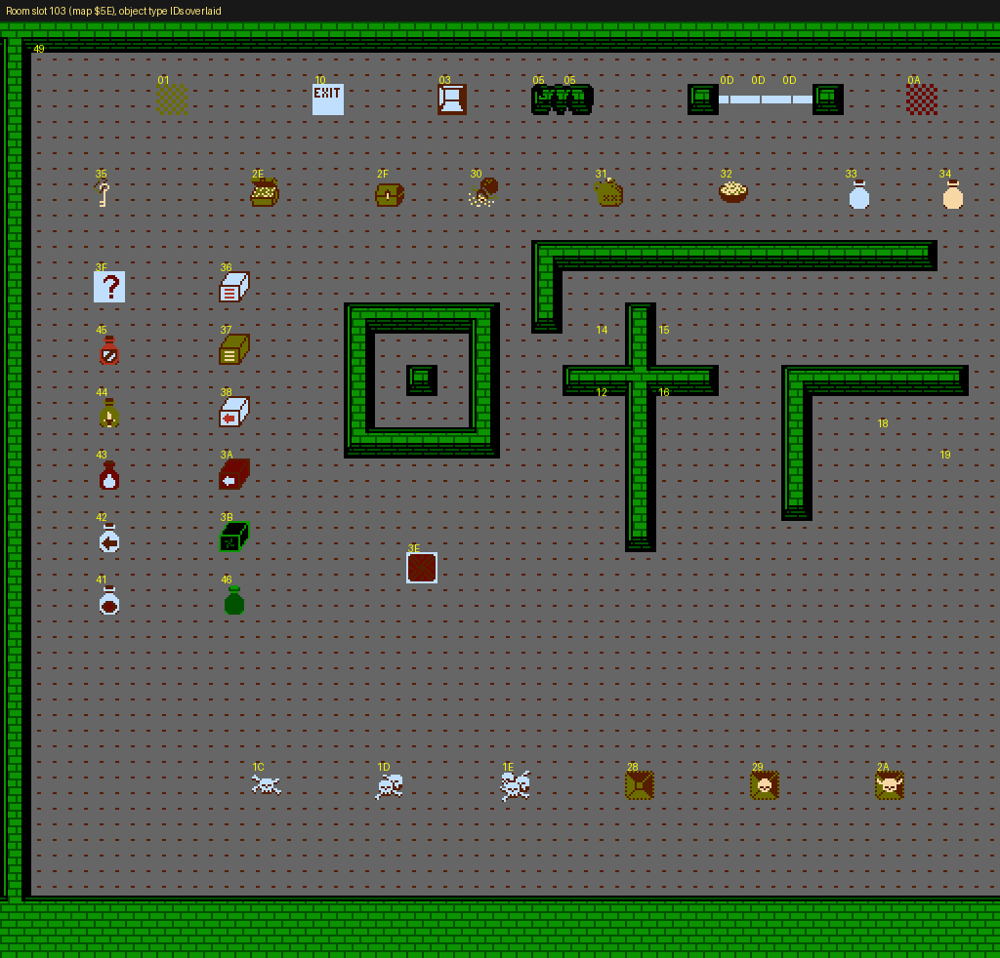

Slot `$66` ("Room 103", map `$5E`) is an object showcase. Along the top are special floor and wall tiles, the exit and a force field. Below them are the key, treasure, chest, food and potions, then a column of power-up boxes, a column of potions including the Extra Magic potion (`$43`), and every grade of monster generator along the bottom.

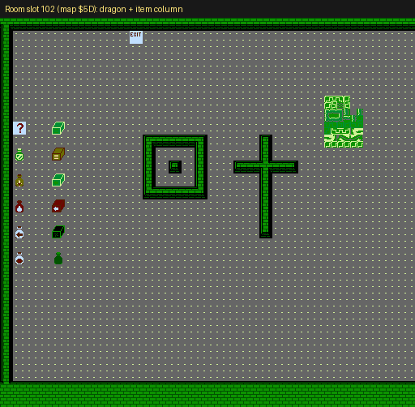

Slot `$65` ("Room 102", map `$5D`) has the same square-and-cross walls, a column of potions and power-ups, and the dragon from the Room 100 vault (object types `$3C`, `$48` and `$1B`) at top right.

| Part | Bank / CPU | File offset | Bytes |
| --- | --- | --- | --- |
| Room → map table (104 entries) | 0 / `$87B8` | 0x007C8 | 00 01 02 17 … |
| Slots `$64`–`$67` | 0 / `$881C` | 0x0082C | 47 5D 5E 5F |
| Map pointer table | 0 / `$8A75` | 0x00A85 | 2 bytes per map |
| Map `$5D` data (slot 102) | 6 / `$B182` | 0x0D192 | 00 00 00 00 00 00 BD 41 … |
| Map `$5E` data (slot 103) | 6 / `$B1C5` | 0x0D1D5 | 00 00 00 00 00 00 05 0D … |
| Map `$5F` pointer | 0 / `$8B33` | 0x00B43 | 00 00 |

**Why nothing reaches them.** Each player's room is in `$A8`/`$A9`, and `$A3` takes the higher of the two (`$C741`). An exit adds 1 (`$831C`). A warp exit (type `$11`) jumps to the room in its contents-list byte, and every one in the game lands between Rooms 13 and 97. When a clue room's timer runs out, the game sends players to one of the eight rooms in the table at `$C601` (19, 27, 47, 55, 68, 71, 82, 91). Room 100 (`$63`) is the last one handled, at `$C789`. Only the attract demo writes a room number directly, and it writes `$64` (`$C6A4`).

**To visit:** on a new game, break at `$C738` and set `$A8` and `$A9` to `$65` or `$66` before continuing. A Game Genie code that swaps Room 1 for either map is in the last section.

## 3. Six level maps no room uses — Leftovers

The map pointer table has entries for maps `$57`–`$5C`, and their data is intact in bank 6, but no slot in the room table points at them. Four are layouts that appear nowhere in the game. The other two are early versions of maps that did ship.

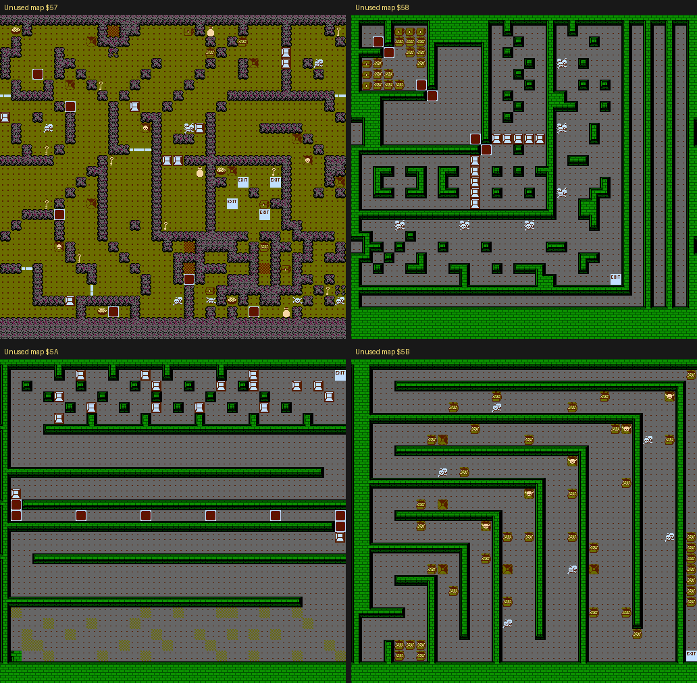

Each map holds its own walls and objects. Loading one into Room 1's slot gives a playable level with an exit. Map `$57` is a clue-room design: its flags match Room 16's exactly (`$C4` = `$A0`, `$C5` = `$00`). It runs the 99 countdown, a "?" in it would reveal the first letter, and running out of time sends you to Room 19. Section 9 explains how clue rooms work.

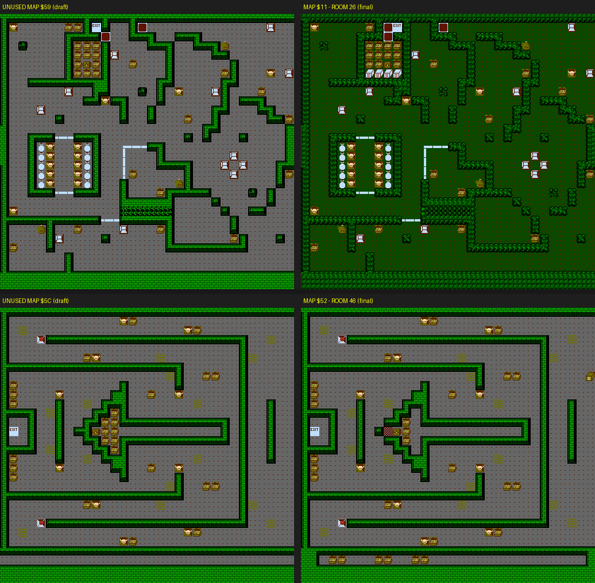

Map `$59` matches Room 26 (map `$11`) on 98.7% of its wall and object tiles but uses a different wall style. Map `$5C` matches Room 46 (map `$52`) on 96.2%, with a few treasures and wall segments moved. Room 46 is the third clue room, and `$5C`'s header carries the same flags (`$C4` = `$82`, `$C5` = `$02`).

Neither timed map has a combination piece of its own. The "?" lives in a room's contents list, not in the map, and these maps never had a room. With the Game Genie codes they borrow Room 1's list and run on into the lists after it, so `$57`'s 4 chests and 7 breakable walls and `$5C`'s chest hold ordinary items. Load `$5C` into Room 46's slot instead and its chest gets Room 46's "?" in the same spot as the shipped room. GSUEAYAE + YUNAOATU (section 11) shows the clue working in it.

| Map | Pointer at (file) | Data at bank 6 / CPU | Data file offset | Closest shipped map |
| --- | --- | --- | --- | --- |
| `$57` | 0x00B33 | `$ACEB` | 0x0CCFB | none (38% at most) |
| `$58` | 0x00B35 | `$AE1A` | 0x0CE2A | none (45%) |
| `$59` | 0x00B37 | `$AEE2` | 0x0CEF2 | Room 26, 98.7% |
| `$5A` | 0x00B39 | `$AFB4` | 0x0CFC4 | none (48%) |
| `$5B` | 0x00B3B | `$B04E` | 0x0D05E | none (41%) |
| `$5C` | 0x00B3D | `$B0E5` | 0x0D0F5 | Room 46, 96.2% |

Similarity counts tile positions where either map has something other than plain floor, compared across the whole 64 × 60 tile room. Maps `$46` and above live in bank 6, chosen by the thresholds at bank 0 `$81CF` (file 0x001DF). The coverage log shows these six pointer entries and their data were never read.

## 4. A tenth wall style — Leftovers

The wall-graphics table has ten entries, but no map selects the tenth. Its 1 KB of tiles (round, bead-like walls over a dashed floor) is never displayed.

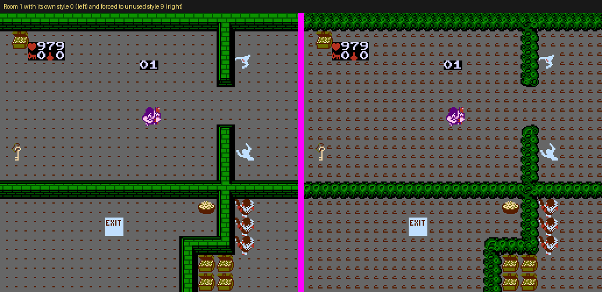

Byte 4 of each map header sets RAM `$63`. Its high nibble picks the background CHR bank through the table at bank 2 `$A3A0`, which is written to register R2 at `$A382`. Across all 95 maps, styles 0–8 are used (21, 9, 9, 9, 5, 14, 13, 13 and 2 maps). Style 9 is used by none.

| Part | Bank / CPU | File offset | Bytes |
| --- | --- | --- | --- |
| Style → CHR bank table | 2 / `$A3A0` | 0x043B0 | 10 11 12 13 14 15 16 17 18 19 |
| Unused entry 9 | 2 / `$A3A9` | 0x043B9 | 19 |
| CHR bank `$19` (1 KB) | CHR `$6400` | 0x26410–0x2680F | never drawn |

The screenshot keeps Room 1's palette, so the colours are not necessarily the ones intended. Setting the high nibble of Room 1's header byte (file 0x08017, `00` → `90`) shows the style in a real room.

## 5. A cut credit line — Leftovers

The credits string table still holds SPECIAL THANKS TO and RANDY BROWELEIT, but the credits script never shows them. Where they would sit, after PAT MCCARTHY under Technical Support, the script has five blank-line codes instead of the usual three.

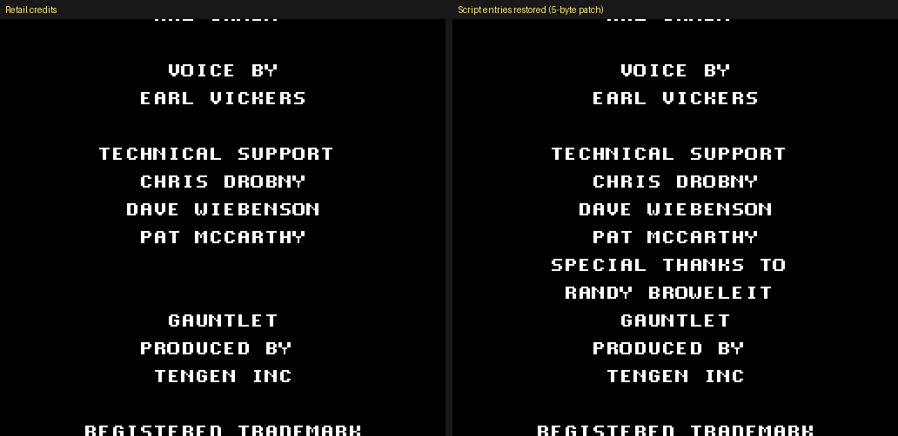

The roll is drawn by bank 3 `$9E20`. It walks a script at `$9E8D` where each byte is a string number (00–1A) or `$80` for a blank line. String numbers index pointers at bank 7 `$BA5E`. Strings `$12` and `$13` are the only two the script never uses, and their bytes were never read in any run.

| Part | Bank / CPU | File offset | Bytes |
| --- | --- | --- | --- |
| String pointer table | 7 / `$BA5E` | 0x0FA6E | 96 BA B1 BA … 95 BB A6 BB … |
| String `$12` SPECIAL THANKS TO | 7 / `$BB95` | 0x0FBA5 | 1C 19 0E 0C 12 0A 15 3F 1D 11 … |
| String `$13` RANDY BROWELEIT | 7 / `$BBA6` | 0x0FBB6 | 1B 0A 17 0D 22 3F 0B 1B 18 20 … |
| Script start | 3 / `$9E8D` | 0x07E9D | 00 80 01 80 80 80 02 80 … |
| The gap (PAT MCCARTHY, 5 blanks, GAUNTLET) | 3 / `$9EBB` | 0x07ECB | 11 80 80 80 80 80 14 |

Changing two bytes of the gap, 0x07ECD to `12` and 0x07ECF to `13`, shows both lines right after PAT MCCARTHY, as in the screenshot. The text uses the game's tile encoding: `00`–`09` are digits, `0A`–`23` are A–Z, `3F` is a space.

## 6. Two unused sound effects — Dormant

Sound IDs `$21` and `$27` are complete, distinct sound effects that the sound driver plays correctly, but no code ever requests them. They are about 0.8 s each: `$21` is a pitch that rises and then falls, and `$27` is a fast descending arpeggio that turns upward at the end.

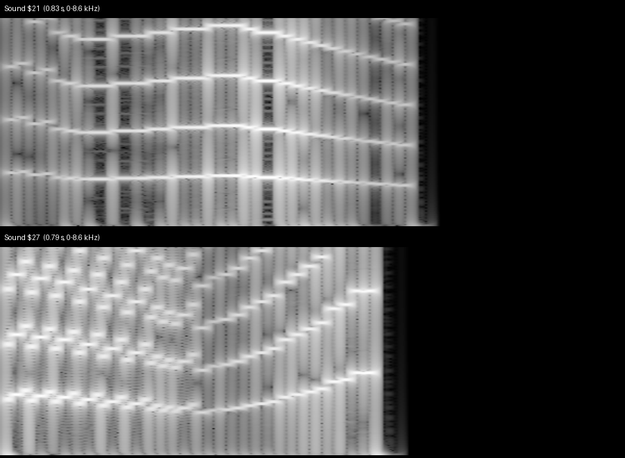

Game code requests sounds by loading an ID and calling `$C248`, which pushes it onto a 5-slot queue at `$BB`–`$BF`. The driver in bank 8 looks each ID up in two tables: a command type at `$9051` and a parameter at `$9087`. Both IDs are type 7 (start a track). `$21` starts track `$1B` and `$27` starts track `$21`; each track has its own stream data. No immediate load of `$21` or `$27` precedes a call to `$C248`, and none of the table-driven requests (hero voice tables, music table `$C615`) can produce them. A few other effects (IDs $11, $13, $15, $20, $29) also never came up during testing, but each of those has a request site in the game code. These two have none.

| Part | Bank / CPU | File offset | Bytes |
| --- | --- | --- | --- |
| Sound `$21` type / parameter | 8 / `$9072`, `$90A8` | 0x11082 / 0x110B8 | 07 / 1B |
| Sound `$27` type / parameter | 8 / `$9078`, `$90AE` | 0x11088 / 0x110BE | 07 / 21 |
| Request routine | 14 / `$C248` | 0x1C258 | 48 A5 BE 85 BF … |

The WAV renders ([sound `$21`](audio/sfx_21.wav), [sound `$27`](audio/sfx_27.wav)) were made by running the ROM's own sound driver (banks 8, 9, 14 and 15) as an NSF. Two other IDs never request anything: `$00` is the queue's empty-slot marker, and `$2A` is a silent "stop sound $29" command (type 5) that nothing sends.

## 7. Item type $40 — Unfinished

Item type `$40` is defined in the tables but sits in no room, not even the test rooms, and in no room's contents list. Nothing creates it, though it works when forced in.

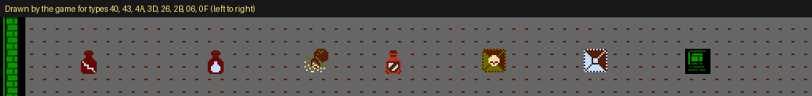

**Type `$40`** completes the potion set `$40`–`$45`. It uses graphic `$77`, next in sequence after the five shipped potions (`$76`–`$72`), and the same pickup handler. Its bit is bit 0 of `$AC`, the bit the Orb (`$4B`, handler at `$83AF`) also sets. The end-of-game check at `$C0EB` treats that bit as "has the Orb". When forced into Room 1 in the emulator, picking up `$40` sets the bit and shows an icon in the status screen's first inventory slot. Whether it was an early Orb or a sixth potion dropped because of the clash is guesswork.

**Type `$3D` is not an item.** It is the room loader's marker for "take this object's type from the room's contents list" (bank 0 `$8486`). Shipped rooms use it to place potions and other items numbered `$3F` and up, including the "?" blocks in Rooms 16 and 66. A `$3D` never survives loading, which is why the power-up handler stops at `$3B` and its graphic entry just repeats `$72`.

| Part | Bank / CPU | File offset | Bytes |
| --- | --- | --- | --- |
| Graphic number, type `$40` | 2 / `$BBD0` | 0x05BE0 | 77 |
| Flag byte, type `$40` | 2 / `$B3BB` | 0x053CB | 01 |
| Potion handler, types `$40`–`$45` | 1 / `$82D0` | 0x022E0 | 84 89 A8 B9 7B B3 15 AC 95 AC |
| Orb handler (sets the same bit as `$40`) | 1 / `$83AF` | 0x023BF | B5 AC 09 01 95 AC 4C ED AB |
| Ending check | 14 / `$C0EB` | 0x1C0FB | B5 AC 4A B0 20 |

Tested by turning Room 1's first key into `$40`: it set `$AC` to `01` and vanished. No code loads `#$40` into the object table and no room's contents list holds it, so nothing in the game creates it.

## 8. Random-input demo mode and orphaned code — Fossils

### Game mode `$12`: a random-input demo

The NMI dispatch tables run one entry past the last mode the game uses. Mode `$12` has a handler (`$8031`, the in-game one) and its own input code, but nothing ever sets mode `$12`.

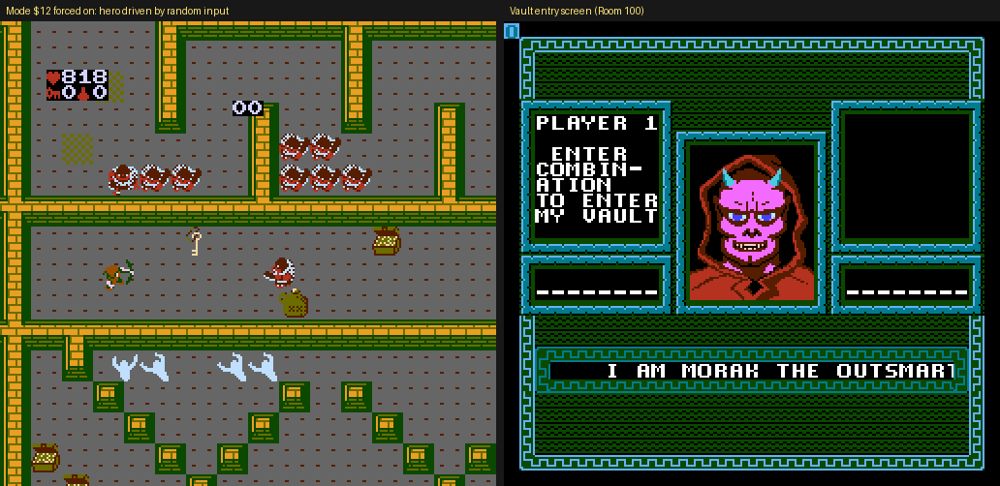

In mode `$12` the joypad routine replaces the player's input with random presses: it takes the frame counter, masks off Select and Start, and holds that for a short random number of frames. The NMI counts a timer at `$14` down each frame, and the mode ends when the timer runs out or Start is pressed. Forced on in the attract demo, the hero wanders the demo room under random control. Nothing sets the timer, and the room loader clears `$14`, so the mode ends at once unless the timer is set after the room loads. When it ends, the game takes the regular exit path instead of returning to the title, so it lands on a Morak screen.

The shipped attract demo uses mode `$02` instead, which replays recorded input stored at `$CB1F`. Mode `$12` looks like the earlier approach that it replaced.

| Part | Bank / CPU | File offset | Bytes |
| --- | --- | --- | --- |
| NMI handler table, entry `$12` | 14 / `$C1E9` | 0x1C1F9 | 31 80 |
| NMI bank table, entry `$12` | 14 / `$C1FD` | 0x1C20D | 00 |
| Mode check in joypad routine | 14 / `$C3AD` | 0x1C3BD | A5 C2 C9 02 F0 D7 C9 12 F0 01 60 |
| Random input generator | 14 / `$C3E3` | 0x1C3F3 | AD B3 01 D0 0E A5 09 09 03 … |
| Timer countdown in NMI | 0 / `$80E4` | 0x000F4 | A5 C2 C9 12 D0 06 A5 14 F0 02 C6 14 |

Every store to `$C2` in the ROM is a constant from `$00` to `$11` or a saved value being restored. None is `$12`.

### Orphaned routines

These routines have no caller, no jump-table entry and no pointer anywhere in the ROM, and none ran in any test.

| Bank / CPU | File offset | What it does |
| --- | --- | --- |
| 12 / `$810D`–`$8180` | 0x1811D | Writes two 30-byte rows to the PPU from a pointer table at `$8181`. That address is now code (the room-type routine), and it reads the same byte for the low and high halves of the pointer, so the table it was written for is gone. |
| 0 / `$86C8` | 0x006D8 | Removes every dragon piece (types `$1B`, `$48`, `$3C`) from the room. The live version in bank 12 `$81FA` (file 0x1820A) removes only `$3C` and `$48`. |
| 1 / `$8093` | 0x020A3 | Finds the first monster (types `$12`–`$1B`) in the object list and removes it through the normal remove routine `$ABED`, saving and restoring X and Y. |
| 1 / `$8108` | 0x02118 | Copies one object's `$0580` byte to another and zeroes the second one's `$0600` byte. |
| 1 / `$8F1F` | 0x02F2F | A lone `JMP $A5DA`, then a routine that clears bit 0 of `$0F,X` when `$0600,X` is zero. |
| 2 / `$B1D1` | 0x051E1 | A fragment after an RTS: compare, play sound `$17`, jump back. |
| 14 / `$CA17` | 0x1CA27 | Meant to clear the sprite page at `$0200`, but its loop uses BEQ where BNE was needed (A0 00 98 99 00 02 C8 F0 FA 60), so it would clear one byte and return. |

The room loader in bank 0 also has a disabled condition: `LDA $64` / `CMP #$2A` / `BCC +0` at `$8293` (file 0x002A3, bytes A5 64 C9 2A 90 00). The branch lands on the next instruction, so the test does nothing. Someone switched the check off rather than deleting it.

## 9. Hidden in Plain Sight

### The vault combination is NUKIEDOG

The eight-character combination for Morak's vault is the word NUKIEDOG in disguise. Each letter's ASCII code is XORed with a 5-bit key and the low 5 bits pick a character from the game's 32-character alphabet, which leaves out J, Q, V and 0.

```
letter[i] = ALPHABET[(ASCII("NUKIEDOG"[i]) XOR key) AND $1F]
ALPHABET  = ABCDEFGHIKLMNOPRSTUWXYZ123456789
```

The key is in `$D8` (player 1) or `$D9` (player 2). A new game picks it from the frame counter (`$954D`: frame counter AND `$1F`), so the combination changes from game to game. The key is also the first character of the password. The widely shared password 43C BBI HYY starts with 4, which is key `$1A`, and that gives XRTW98Y7, the combination players have long quoted for it.

| Part | Bank / CPU | File offset | Bytes |
| --- | --- | --- | --- |
| "NUKIEDOG" (vault screen copy) | 3 / `$8EEA` | 0x06EFA | 4E 55 4B 49 45 44 4F 47 |
| "NUKIEDOG" (ending screen copy) | 12 / `$877E` | 0x1878E | 4E 55 4B 49 45 44 4F 47 |
| Combination check | 13 / `$A281` | 0x1A291 | compares each entry XOR key with 0E 15 0B 09 05 04 0F 07 |
| Alphabet | 3 / `$9B99` | 0x07BA9 | 0A 0B 0C … 23 01 02 … 09 |

The check never stores the combination itself. It compares each letter typed, XORed with the key, against the low 5 bits of N, U, K, I, E, D, O and G. Each of the eight clue rooms reveals one letter, as the next part shows.

### The clue letters hide in chests and a breakable wall

Eight timed rooms each hold one "?" that reveals one letter of the combination. Only Rooms 16 and 66 leave it in the open. Five lock it in a chest that needs a key, and Room 70 seals it inside a breakable wall.

| Room | Letter | Where the "?" is | If the timer runs out |
| --- | --- | --- | --- |
| 16 | 1st | In the open | Room 19 |
| 26 | 2nd | Locked chest | Room 27 |
| 46 | 3rd | Locked chest | Room 47 |
| 54 | 4th | Locked chest | Room 55 |
| 66 | 5th | In the open | Room 68 |
| 70 | 6th | Inside a breakable wall | Room 71 |
| 81 | 7th | Locked chest | Room 82 |
| 90 | 8th | Locked chest | Room 91 |

Bit 7 of the room flags `$C4` makes a room timed: a countdown from 99 replaces the room number on the HUD. The low 3 bits of `$C5` pick both the letter and the room the timer sends you to. Grab the "?" and leave by an exit before the countdown ends, and the Morak screen says YOU HAVE FOUND A CLUE TO FINDING THE ORB with that letter in place. Let the timer run out and it says YOU WILL NEVER FIND THE ORB NOW HA HA HA.

The "?" is never stored in a map. Map data holds only each object's type and position. At load, chests (type `$2F`), breakable walls (`$04`), warp exits (`$11`) and the marker type `$3D` each take the next byte of the room's contents list. A chest or wall keeps it as its contents, a warp exit as its destination, and `$3D` turns into that type. The lists hang off a pointer table indexed by room number, not by map, so a map that no room uses has no list. Room 46's list, `46 00 3F 46`, is what puts the "?" in its chest.

| Part | Bank / CPU | File offset | Bytes |
| --- | --- | --- | --- |
| Contents-list pointers, one per room slot | 0 / `$8820` | 0x00830 | EE 88 EF 88 EF 88 … |
| Room 46 contents list | 0 / `$898C` | 0x0099C | 46 00 3F 46 |
| Loader: `$04`, `$2F` and `$11` read a byte | 0 / `$84C3` | 0x004D3 | 20 25 00 9D 80 05 |
| Loader: `$3D` takes its type from the list | 0 / `$8486` | 0x00496 | C0 3D D0 0F 20 B9 C9 20 25 00 9D 00 04 |
| Chest opened with a key | 1 / `$8C9B` | 0x02CAB | A6 76 B5 AE F0 F9 |
| "?" pickup sets `$C5` bit 5 | 1 / `$83B8` | 0x023C8 | A9 20 05 C5 85 C5 |
| Letter drawn on the Morak screen | 3 / `$8E62` | 0x06E72 | A5 C5 29 20 F0 38 |
| Where the timer sends you | 14 / `$C601` | 0x1C611 | 12 1A 2E 36 43 46 51 5A |

### The Extra Magic potion is in two rooms

Item type `$43`, the Extra Magic potion, is in two shipped rooms but never in plain view. Room 16 keeps it in a locked chest and Room 50 inside a breakable wall, so it appears only once you open one. Both test rooms also have one out in the open. Picking it up sets bit 3 of the player's potion byte (`$AC`). When the player then uses a magic potion (B button), `$9BC2` copies that bit into the effect flags. That moves the lookup into the second half of the potion table at bank 2 `$BC28` (file 0x05C38), where almost every monster entry is 00, meaning destroyed outright, instead of the small damage values in the first half.

| Part | Bank / CPU | File offset | Bytes |
| --- | --- | --- | --- |
| Room 16 contents list (chest) | 0 / `$8905` | 0x00915 | 3F 43 0B 31 35 0C 46 0A 92 |
| Room 50 contents list (wall) | 0 / `$8993` | 0x009A3 | 31 18 18 18 43 |
| Pickup handler, types `$40`–`$45` | 1 / `$82D0` | 0x022E0 | 84 89 A8 B9 7B B3 15 AC 95 AC |
| Bit for `$43` | 2 / `$B3BE` | 0x053CE | 08 |
| Graphic number for `$43` | 2 / `$BBD3` | 0x05BE3 | 74 |
| Magic potion use | 1 / `$9BBD` | 0x03BCD | … B5 AC 29 08 05 04 … |

An object dump taken as each room loads misses both copies, because a chest or wall shows what it holds only when opened. In the emulator, opening Room 16's chest with a key and shooting Room 50's wall each dropped the potion, and picking it up set `$AC` to `08`. The status screen has an inventory slot for it.

### Password instructions appear only after a game over

On power-up, the player-count screen shows only HOW MANY PLAYERS. After a game over in which the game kept password data for a player, the same header cycles through HOW MANY PLAYERS, TO ENTER PASSWORD and HOLD A AND PRESS START. That is the only place the game explains how to reach the password screen.

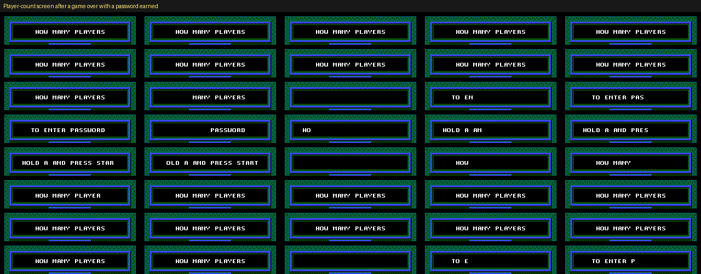

The header code moves to the next message only when `$D8` or `$D9` is non-zero (`$8053`). At game over, `$82B8` clears a player's key when all eight of that player's password bytes (`$C8`–`$D6`) are zero.

| Part | Bank / CPU | File offset | Bytes |
| --- | --- | --- | --- |
| Header string pointers | 3 / `$8203` | 0x06213 | 0F 82 27 82 3F 82 |
| TO ENTER PASSWORD | 3 / `$8227` | 0x06237 | 24 tiles |
| HOLD A AND PRESS START | 3 / `$823F` | 0x0624F | 24 tiles |
| Cycling condition | 3 / `$8053` | 0x06063 | A5 D8 05 D9 F0 04 E0 03 90 02 A2 00 |
| Game-over clear | 3 / `$82B8` | 0x062C8 | A2 00 A9 00 15 C8 E8 E8 E0 10 … 85 D8 |

### A+B+Select+Start soft reset

Holding A, B, Select and Start together resets the game to the title screen from anywhere: in play, on the title or in the menus. The joypad routine checks for all four on two reads in a row, clears the warm-boot marker at `$018D` and jumps to the reset code. In play, Start opens the pause screen first, and the reset follows. File 0x1C3AD, bank 14 `$C39D`: A5 9D 25 9F C9 F0 D0 08 A9 00 8D 8D 01 4C 90 FF.

### The attract demo has its own room

The demo is not one of the 100 rooms. The demo code sets the room to slot `$64` ("Room 101", `$C6A4`, file 0x1C6B4: A9 64 85 A3 85 A8). That slot reuses Room 85's maze (map `$47`, table entry at file 0x0082C) with a monster and item layout of its own, and the HUD shows its room number as 00. The recorded joypad input it replays starts at `$CB1F` (file 0x1CB2F).

## 10. Checked and not found

- **Cheat codes.** The only button combinations the code looks for are the soft reset and A held with Start for the password screen. Controller 2 is read every frame and only drives player 2.
- **Debug menus or a level select.** None besides the palette editor. No code reads controller 2 for anything special, and no mode besides `$0E` and `$12` is unreachable.
- **Regional leftovers (Lost in Translation).** No Japanese text, kana tiles or second-language strings. All text uses the US font.
- **Empty space.** PRG banks 10 and 11 (file 0x14010–0x1800F, 16 KB) are all zeros. Most other banks end in zero padding.
- **Voice samples.** The six DPCM clips at `$CB80`–`$FF80` (credited to Earl Vickers) are all reachable through the hero voice tables, sound IDs `$2F`–`$35`. IDs `$2F` and `$30` play the same clip at two playback rates.
- **Sound driver features.** Command types 1, 2, 4, 6 and 8–C have handlers but no sound ID uses them. That is normal for a general-purpose driver, so they are not listed as cut content.
- **Sprite graphics.** About 1,000 sprite tiles in the hero and monster banks never showed up during testing. Random play cannot rule out a rare animation frame, so none is claimed as unused. The one CHR bank listed above (style 9) is tied to a table entry no map selects.

## 11. See it yourself

**IPS patch.** [`patch/gauntlet-extras-menu.ips`](patch/gauntlet-extras-menu.ips) adds a boot menu that opens the vault screen, plays both unused sounds, gives Room 1 wall style 9 and opens the palette editor, with no codes or debugger. The [README](README.md) explains how to use it.

**Game Genie (8-letter).** Most codes swap the map Room 1 loads, so start a new game to see it. The compare byte matches only bank 0, and the codes were checked by decoding them and patching the same bytes in the emulator, not on real Game Genie hardware.

| Code | Effect |
| --- | --- |
| TSUEAYAE | Room 1 becomes test room 103 (object showcase, map `$5E`) |
| ISUEAYAE | Room 1 becomes test room 102 (dragon room, map `$5D`) |
| YSUEAYAA | Room 1 becomes unused map `$57` |
| ASUEAYAE | Room 1 becomes unused map `$58` |
| ZSUEAYAE | Room 1 becomes unused map `$5A` |
| LSUEAYAE | Room 1 becomes unused map `$5B` |
| PSUEAYAE | Room 1 becomes map `$59` (draft of Room 26) |
| GSUEAYAE | Room 1 becomes map `$5C` (draft of Room 46) |
| GSUEAYAE + YUNAOATU | Room 1 becomes map `$5C` with its clue restored: the top piece of the breakable wall at the end of the long corridor drops a "?". Shoot it, grab it and leave before the timer runs out, and the Morak screen shows the third letter. YUNAOATU also puts a "?" in one container in Room 7. |
| ZOUOSTEA + LOUONTEA | Restores SPECIAL THANKS TO RANDY BROWELEIT in the attract-mode credits |

**RAM to watch or poke.**

| Address | Meaning |
| --- | --- |
| `$A3` | Current room, 0-based (`$00`–`$63` are Rooms 1–100) |
| `$A8` / `$A9` | Room for player 1 / player 2 |
| `$A6` / `$A7` | Hero in bits 0–1: 0 = picked with Up, 1 = Left, 2 = Down, 3 = Right |
| `$B2` + `$B4` | Player 1 power, low and high byte |
| `$AA` / `$AC` | Player 1 power-up bits / potion and Orb bits |
| `$C2` | Game mode (`$01` playing, `$02` attract demo, `$0E` palette editor) |
| `$D8` / `$D9` | Combination key for player 1 / 2 (first password character) |
| `$C8`–`$D6` | Password bytes, players interleaved |
| `$0400`, `$0480`, `$0500` | Object type, X and Y tables (128 slots each) |

**Breakpoints.**

- `$C738`: start of a game's room sequence. Set `$A8`/`$A9` here to warp, including to `$65`/`$66` for the test rooms.
- `$C489`: top of the in-room loop. This is where the palette-editor trampoline in section 1 goes.
- `$C248`: sound request. A holds the sound ID. To hear the unused effects, set A to `$21` or `$27` here.

**Hex searches** (any hex editor, no header needed): `4E 55 4B 49 45 44 4F 47` finds both NUKIEDOG strings. `11 80 80 80 80 80 14` finds the credits gap. `A5 C2 48 A9 0E 85 C2` finds the palette editor's entry.

## Sources

- [Gauntlet Cheats, Codes, and Secrets for NES — GameFAQs](https://gamefaqs.gamespot.com/nes/587296-gauntlet/cheats): the 43C BBI HYY passwords and the XRTW98Y7 combination used to check the NUKIEDOG formula.
- [Gauntlet (NES) — StrategyWiki](<https://strategywiki.org/wiki/Gauntlet_(NES)>): background on the 100 rooms, clue rooms and password system.
- Everything else comes from the ROM (MD5 d6c977caa1d5a1deaeedbfe5668db01d) and emulator runs. The Cutting Room Floor was not consulted.
